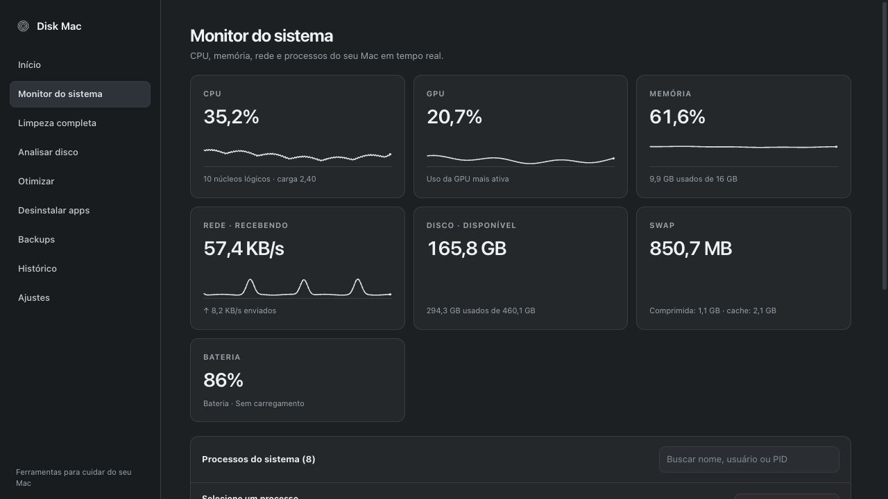
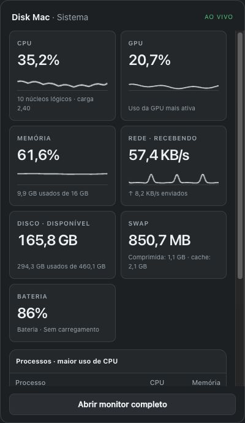
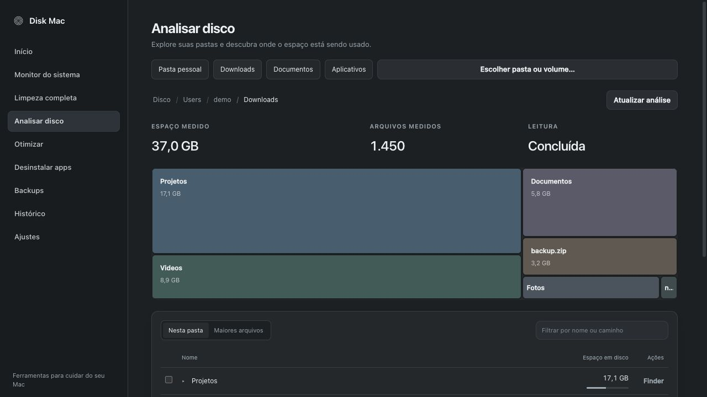
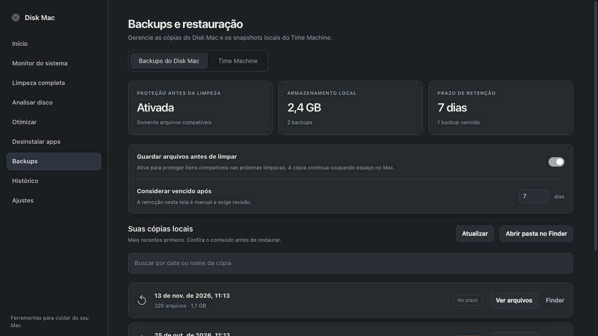

<p align="center">
  
</p>

<h1 align="center">Disk Mac</h1>

<p align="center">
  Limpe espaço, acompanhe o desempenho e cuide do seu Mac em um só app.
</p>

<p align="center">
  <a href="#o-que-você-pode-fazer">Recursos</a> ·
  <a href="#barra-de-menus">Barra de menus</a> ·
  <a href="#começar">Começar</a> ·
  <a href="#linha-de-comando">CLI</a>
</p>

O **Disk Mac** é um app para macOS com interface em português do Brasil e modos claro e escuro. Nasceu como um fork de [mac-cleaner-cli](https://github.com/guhcostan/mac-cleaner-cli), de Gustavo Costa, e foi remodelado em torno do app desktop. Ele mantém a CLI e reaproveita suas rotinas de limpeza, com nova identidade visual, navegação própria e ferramentas para analisar o armazenamento, monitorar processos e gerenciar backups.



*As capturas mostram a interface atual com dados de demonstração.*

## O que você pode fazer

| Tela | Para que serve |
| --- | --- |
| **Monitor do sistema** | Acompanhe CPU, memória, rede, disco, swap, bateria e GPU quando o driver disponibilizar a leitura. Pesquise processos por nome, usuário ou PID, ordene por consumo e finalize processos do seu usuário quando permitido. |
| **Limpeza completa** | Veja uma prévia do que a limpeza encontrou e escolha as categorias a remover. Você também pode executar uma limpeza rápida ou agendar as categorias compatíveis em **Ajustes** e consultar as execuções no **Histórico**. |
| **Analisar disco** | Abra uma pasta ou volume, explore o mapa de espaço, encontre os maiores arquivos e revise o que deseja mover para a Lixeira. |
| **Otimizar** | Reúne as rotinas de manutenção em uma tela, com ações para Quick Look, DNS, Spotlight e verificação de volume, entre outras. Selecione as rotinas e acompanhe o resultado de cada uma. |
| **Desinstalar apps** | Remova aplicativos `.app` e pacotes do Homebrew, incluindo fórmulas e casks. Revise os arquivos relacionados encontrados antes de removê-los. Instaladores `.pkg` podem exigir o desinstalador do fornecedor. |
| **Backups** | Guarde itens compatíveis antes da limpeza, veja arquivos e conflitos antes de restaurar e revise as cópias vencidas. A aba **Time Machine** permite consultar os snapshots locais. |

Os gráficos do monitor mostram os últimos dois minutos. Com o monitor visível, o intervalo alvo para ler CPU, GPU, memória e rede é de **500 ms**. A lista de processos tem uma coleta separada, a cada **2 s**. Para encerrar um processo, selecione-o e escolha **Finalizar processo…**. O encerramento forçado exige uma confirmação adicional.

### Barra de menus

<p>
  
</p>

Em **Ajustes**, ative **Monitor do sistema na barra de menus**. O ícone em forma de linha abre um painel compacto com indicadores do Mac e os processos que mais usam CPU. Ao lado do ícone, você pode exibir o uso de **CPU** ou **memória**, a taxa de **download** ou **upload**, ou deixar o valor oculto.

Fechar a janela mantém o Disk Mac na barra de menus. Com o monitor e o painel fechados, o app atualiza apenas a métrica escolhida, a cada **5 s**. A opção **Oculto** pausa essa coleta. Para sair de vez, use **Encerrar Disk Mac** no menu do ícone ou `⌘Q` na janela principal.

### Análise de disco e backups



O mapa ajuda a encontrar o que ocupa espaço e a explorar as subpastas. Em volumes APFS, arquivos podem compartilhar espaço, então o tamanho medido pode ser diferente do espaço que a remoção libera.



As cópias do Disk Mac continuam ocupando espaço e preservam o arquivo existente em caso de conflito na restauração. Para proteger o Mac inteiro, use o Time Machine.

## Começar

Se houver um pacote publicado em [Releases](https://github.com/JandersonJean/disk-mac/releases), baixe o `.dmg` para seu Mac: **arm64** para Apple Silicon ou **x64** para Intel. Abra a imagem e arraste o Disk Mac para **Aplicativos**.

Para rodar a partir do código no macOS, use **Bun** e **Node.js 22.18+ ou 24.11+**:

```bash
git clone https://github.com/JandersonJean/disk-mac.git
cd disk-mac
bun install --frozen-lockfile
cd desktop
bun install --frozen-lockfile
bun run start
```

Para gerar um instalador local, execute `bun run dist` dentro de `desktop/`. Os arquivos `.dmg` e `.zip` são gerados em `desktop/release/`. Veja a [documentação do desktop](desktop/README.md) para detalhes de compilação e empacotamento.

O macOS protege algumas pastas. Para incluí-las nas leituras, autorize o Disk Mac em **Ajustes do Sistema → Privacidade e Segurança → Acesso Total ao Disco**. Ações que exigem administrador pedem autorização pelo próprio macOS.

## Linha de comando

O projeto mantém a CLI original, `mac-cleaner-cli`. Depois de instalar as dependências na raiz, execute:

```bash
bun run dev --help
bun run dev categories
bun run dev scan --json
bun run dev clean --categories browser-cache,system-logs --dry-run
```

`scan` só faz a leitura e `--dry-run` mostra o que seria limpo sem remover arquivos. A CLI também oferece os comandos `uninstall`, `maintenance`, `config` e `backup`. Use `--help` depois do nome de um comando para ver suas opções. Para compilar a CLI, execute `bun run build` na raiz. Você poderá chamar o resultado com `node dist/index.mjs`.

## Créditos e licença

O Disk Mac preserva o histórico e a licença [MIT](LICENSE) do projeto original, [guhcostan/mac-cleaner-cli](https://github.com/guhcostan/mac-cleaner-cli). O monitor se inspira no Monitor de Atividade do macOS. **Otimizar** e **Analisar disco** se inspiram nos fluxos do [Mole](https://github.com/tw93/Mole), com implementação própria em TypeScript. O Disk Mac funciona sem instalar o Mole.

Para colaborar, consulte o [guia de contribuição](CONTRIBUTING.md) e as [orientações do projeto](AGENTS.md). Use as [Issues do Disk Mac](https://github.com/JandersonJean/disk-mac/issues) para reportar um problema ou sugerir uma melhoria. Para vulnerabilidades, consulte a [política de segurança](SECURITY.md).
