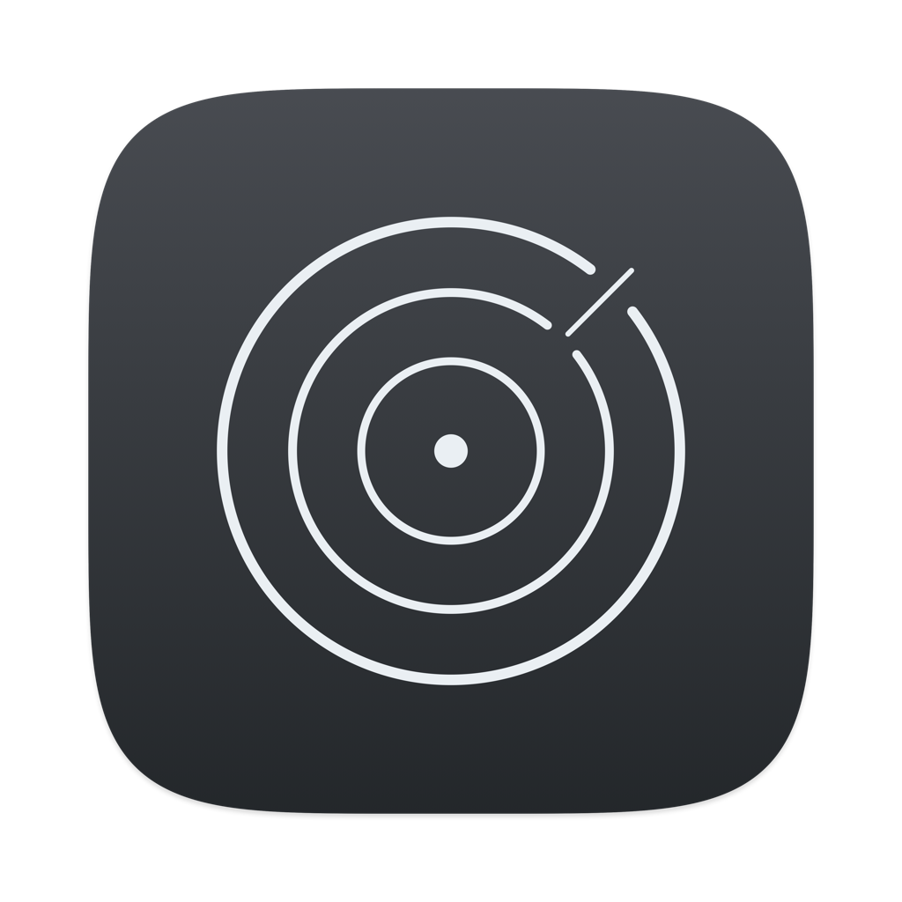
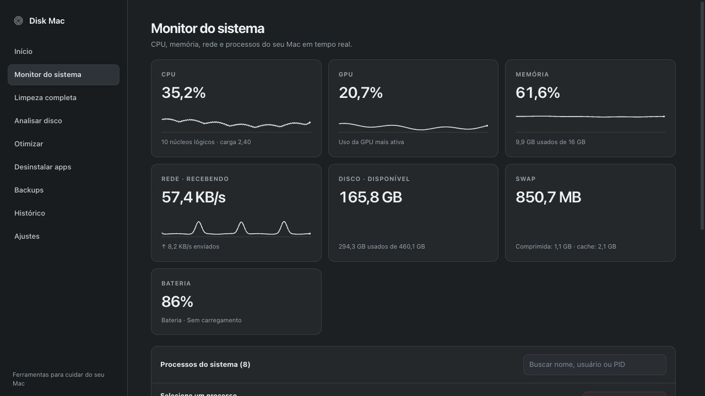

# Disk Mac — aplicativo desktop

A macOS desktop app in Brazilian Portuguese, with a menu bar shortcut. It reuses the
scanners and maintenance routines from [`mac-cleaner-cli`](https://github.com/guhcostan/mac-cleaner-cli), and shares the
CLI's backup configuration.

<p align="center"></p>



*Captura da interface atual com dados de demonstração.*

## What it does

| | |
|---|---|
| **Desktop window and menu bar** | Open the full window from the Dock or the menu bar shortcut. |
| **Daily automatic clean** | Once a day at the time you pick (default 10:00) it quietly cleans the categories you selected. If the Mac was asleep or off at that time, it runs as soon as it wakes. It never runs twice on the same day, and right after install it waits for the first scheduled time instead of cleaning immediately. |
| **Clean Now** | Runs the same selection as the daily clean, on demand. |
| **Deep Clean** | Scans the CLI categories, shows sample paths, and removes only the selections confirmed by the user. When backups are enabled, supported files are moved to backup. |
| **Uninstall** | Finds `.app` bundles and Homebrew casks/formulae. Uses Homebrew for package removal and offers related per-user files for review. |
| **Backups** | Separate Disk Mac and Time Machine tabs. See backup counts, size and retention, inspect original paths and conflicts before restoring, and review expired copies before moving them to the Trash. Existing destination files are never overwritten. |
| **System monitor** | Live CPU, GPU when reported by the driver, memory, swap, network, disk space, battery and a searchable process table. A small line icon opens a compact system dashboard and can show a live value beside it. |
| **Otimizar** | Review and run selected macOS routines: QuickLook cache, session icon service, DNS, application associations, Spotlight reindexing, periodic maintenance when available, read-only volume verification and opt-in file-cache purging. Caches/services and advanced diagnostics are grouped in one screen; the duplicate Maintenance menu has been removed. Each routine shows its own outcome. |
| **Analisar disco** | Choose a folder or volume, explore a proportional space map, navigate subfolders, filter the list and review the 50 largest files. Analysis runs in a cancellable worker. Selected items can be moved to the Trash after confirmation. |

The **Otimizar** and **Analisar disco** workflows are inspired by [`mo optimize` and `mo analyze` from Mole](https://github.com/tw93/Mole), with an independent TypeScript implementation integrated into Disk Mac. Mole is not bundled or required, and this is not a complete port of its optimization catalog.

Disk analysis measures allocated filesystem blocks without reading file contents. It does not follow symbolic links or traverse other mounted volumes, and counts hard-linked file data once. APFS clones may share blocks, so measured totals are not a promise of reclaimable space. Permission failures and the scan limits (120 seconds, one million visited entries, 5,000 immediate children) produce explicitly partial results. Open a smaller folder for detail. Trash selection is limited to 100 reviewed items, expires after 15 minutes and rechecks item identity before moving it. System locations, applications and Disk Mac's own data are protected.

The former “Espaço purgável” action is now labelled **Cache de arquivos na memória** under advanced optimization. The [Apple `purge` manual](https://github.com/apple-oss-distributions/system_cmds/blob/main/purge/purge.8) describes a disk buffer cache reset, not deletion of stored files. It is not selected by default, and its description warns about slower subsequent reads.

### Safety

- Unattended runs (daily and Clean Now) can only use categories that are **not** marked risky. This is enforced in the main process, not just in the UI.
- Automatic runs skip temp files touched in the last 24 hours (configurable) because running apps may still be using them.
- Deep Clean only acts on a fresh preview. If it is older than 15 minutes, the app asks you to scan again.
- The uninstaller handles `.app` bundles and Homebrew packages. Standalone `.pkg` installers can require vendor-specific uninstallers; there is no universal safe way to reverse every package receipt.
- Administrator routines in **Otimizar** and reviewed Time Machine snapshot deletion request authorization through the macOS system dialog. Disk Mac never collects or stores the password. Cancelling optimization authorization stops the remaining queue. Snapshots start unselected and require a separate permanent-deletion review in **Backups → Time Machine**.
- Expired Disk Mac backups go to the Trash only after a fresh review. The app checks the selected session identities and their contents again before moving them. Moving them to the Trash does not immediately free space.
- Restoration uses non-overwriting filesystem operations and preserves the backup copy on a destination conflict. Symlinks are restored as links; destination parents pointing outside the user home are rejected. Empty sessions are removed only after successful restoration.
- Backed-up files still occupy disk space until the backup is restored or removed.
- The UI runs in a sandboxed renderer with a strict Content Security Policy and no Node.js access; it can only call the handful of actions exposed by the preload script.

### Default automatic categories

`temp-files`, `browser-cache`, `system-logs`. You can add any other non-risky category (Homebrew, User Cache, Trash, Development Cache, Docker…) in **Settings**.

## Install a local build

```bash
npm install                  # repository root
cd desktop
npm install
npm start                    # build and launch the desktop app
npm run dist                 # create a local .dmg and .zip
```

After packaging, open the `.dmg` from `desktop/release` and copy the app to Applications.
Grant **Full Disk Access** in System Settings → Privacy & Security → Full Disk Access if
you want the app to scan locations macOS otherwise hides.

### Why no Gatekeeper warning?

The app isn't signed with an Apple Developer ID yet (it is ad-hoc signed). macOS only runs
the Gatekeeper check on files tagged with the `com.apple.quarantine` attribute, which
browsers, Mail and AirDrop add to downloads. `curl` and Node's `fetch` don't, so the
installers above produce an app that opens normally. Nothing is bypassed on your Mac: it is
the same as building the app yourself.

### Installing from the .dmg

`Disk-Mac-<version>-arm64.dmg` (Apple Silicon) and `-x64.dmg` (Intel) are available once published on
[Releases](https://github.com/JandersonJean/disk-mac/releases). Because they are
downloaded with a browser, macOS says *"Apple could not verify 'Disk Mac' is free of
malware"* the first time. Either:

- open **System Settings → Privacy & Security** and click **Open Anyway** (on older macOS:
  right click the app → **Open** → **Open**), or
- run `xattr -dr com.apple.quarantine "/Applications/Disk Mac.app"`.

### Limits of unsigned builds

- macOS ties the Full Disk Access permission to the app's signature, and ad-hoc signatures
  change on every build, so you may need to grant it again after updating.
- There is no in-app auto-update (it requires a signed app on macOS): run the install
  command again to update.

Signing and notarizing with a Developer ID removes all of the above; see
[Releasing](#releasing).

## Develop

Requires Bun (or npm) and Node 22+. The app bundles code from the CLI, so install the root
dependencies too.

```bash
bun install              # at the repository root
cd desktop
bun install
bun run start            # build (with sourcemaps) and launch Electron
bun run test             # unit tests for the scheduler, settings, store and clean engine
bun run typecheck
bun run dist             # package .dmg + .zip for arm64 and x64 into desktop/release (macOS only)
bun run screenshots      # regenerate ../assets/screenshots from the built renderer with sample data
```

`bun run screenshots` renders the real popover UI (from `dist/renderer`, so run
`bun run build` first) inside a mock macOS desktop (`scripts/screenshots/stage.html`), in
light and dark mode, with Playwright and Chromium. Set `CHROMIUM_PATH` to use a Chromium you
already have.

State (settings + history) is stored in `~/Library/Application Support/Disk Mac/state.json`.
On first launch, Disk Mac copies state from `Mac Cleaner Fork Test` or `Mac Cleaner` if it
finds an older installation and the new data file does not exist.

### Layout

```
desktop/
├── src/main/          Electron main process
│   ├── main.ts        tray icon, popover window, IPC, scheduler timer, notifications
│   ├── controller.ts  orchestrates scans/cleans, busy guard, state for the UI (Electron-free)
│   ├── engine.ts      scan + clean on top of the CLI scanners (Electron-free)
│   ├── schedule.ts    "is the daily run due?" logic (pure)
│   ├── settings.ts    defaults + validation of settings coming from the UI
│   └── store.ts       JSON persistence with atomic writes
├── src/preload/       the only bridge between UI and main process (window.cleaner)
├── src/renderer/      popover UI (plain TypeScript + CSS, no framework)
├── src/shared/        types shared by main, preload and renderer
├── assets/            menu bar template icons
├── build/             app icon + entitlements for packaging
└── scripts/           esbuild bundler, icon generator and README screenshots
```

### Why Electron

The scanners are TypeScript, so Electron lets the app reuse them as-is (no rewrite in
Swift, no bundled Node runtime to call the CLI through a subprocess), keeps one language in
the repo, and lets the logic be unit-tested on any OS. The trade-off is a bigger download
(~100 MB) than a native SwiftUI `MenuBarExtra` app would have.

## Releasing

The **Desktop App** workflow (`.github/workflows/desktop.yml`) builds the app on macOS for
every PR/push that touches `desktop/` or `src/`, uploads the `.dmg`/`.zip` as workflow
artifacts, and attaches them to the GitHub release when a release is published.

To ship a signed and notarized app, add these repository secrets:

| Secret | Value |
|---|---|
| `MAC_CERTIFICATE_P12_BASE64` | base64 of your "Developer ID Application" certificate (.p12) |
| `MAC_CERTIFICATE_PASSWORD` | password of the .p12 |
| `APPLE_ID` | Apple ID email used for notarization |
| `APPLE_APP_SPECIFIC_PASSWORD` | app-specific password for that Apple ID |
| `APPLE_TEAM_ID` | your 10-character team ID |

Without them the build is ad-hoc signed (see the note in [Install](#install)).

Bump `version` in `desktop/package.json` before a release: it is the version shown in the
app and in the file names.

### System monitoring

The **Monitor do sistema** page and the compact panel sample CPU, GPU, memory and network every 500 ms while visible. The process list updates independently every two seconds, and its rows stay in place between process samples. Enable the shortcut under **Ajustes → Monitor do sistema na barra de menus**. Choose **Valor ao lado do gráfico** in settings or in the icon’s context menu to show CPU, memory, download or upload. Closing the main window releases it and keeps Disk Mac in the menu bar. When neither monitor is visible, the app samples the selected value every five seconds. Choosing **Oculto** pauses background monitoring. Dismissing the compact panel releases its window, too. Use **Abrir Disk Mac** in the icon's context menu to reopen the app, or **Encerrar Disk Mac** to quit completely. Process memory uses RSS; used system memory is an estimate from VM statistics. Missing/denied metrics display as unavailable. GPU utilization is read from driver statistics in the I/O Registry while either monitor is visible. Macs that do not expose the counter show it as unavailable. Temperature, fans, energy impact and per-process disk/network rates are not collected. No administrator permission is needed.

Select a process row in the full monitor and choose **Finalizar processo…**. The confirmation identifies its name, PID and user. **Finalizar** sends SIGTERM; **Forçar encerramento…** opens a second confirmation before SIGKILL. Unsaved work may be lost. The menu bar panel remains read-only. The app only permits processes owned by the current user, protects critical macOS components and its own process tree/bundle, and rechecks executable, owner and start time immediately before signaling. A confirmation expires after one minute and can be used once. Results distinguish confirmed exit, a process that is still running, and unavailable verification; the app never escalates to force quit automatically or requests administrator access for this action.

The Disk Mac bundle uses `io.github.guhcostan.diskmac`, separate from the original Mac Cleaner application. Existing Disk Mac settings remain in the same Application Support directory.

Per-process CPU uses the change in accumulated CPU time between samples, divided by elapsed time. One fully occupied core is about 100%. New processes show a dash until a second reading is available. The full monitor initially renders 100 rows and searches the entire process list. Disk capacity, battery and swap refresh independently at a slower cadence so they do not delay the live snapshot.
