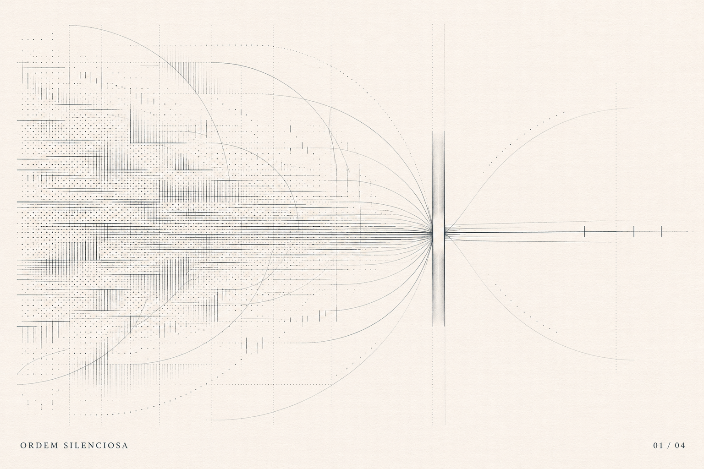

# Ordem Silenciosa

O espaço é uma medida ativa. Formas claras ocupam apenas o necessário; intervalos amplos deixam cada linha respirar e transformam o vazio em parte da composição. A geometria é precisa, mas nunca rígida: pequenas mudanças de espessura e raio dão à estrutura uma presença humana, construída com cuidado artesanal.

A matéria vem de uma escala mineral: grafite, ardósia, cinza claro e branco. Superfícies foscas recebem contornos finos, enquanto brilhos ficam restritos a pontos raros de atenção. A cor não decora; ela assinala uma mudança de estado e retorna ao silêncio quando já cumpriu sua função.

O ritmo nasce da repetição controlada. Marcas pequenas se acumulam em sequências, intervalos e campos de densidade variável; algumas se alinham, outras se dispersam até que a ordem apareça sem ser anunciada. A execução precisa parecer resultado de muitas horas de observação e refinamento, com cada repetição calibrada à mão.

A composição se organiza por um eixo estável e um equilíbrio assimétrico. Grandes áreas calmas convivem com concentrações de traços finos, criando profundidade sem peso. A hierarquia é percebida primeiro pela forma, depois pela escala e só então por palavras breves, tratadas como sinais discretos de um sistema cuidadosamente desenhado.

O acabamento exige revisão paciente: margens exatas, linhas nítidas, contraste legível e nenhum detalhe gratuito. Cada elemento deve parecer deliberado e durável, como a obra de alguém com domínio profundo do ofício. O conjunto final deve revelar precisão de nível mestre sem perder leveza, clareza ou espaço para interpretação.

